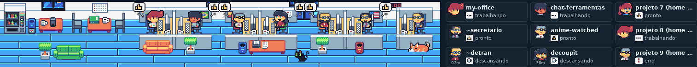
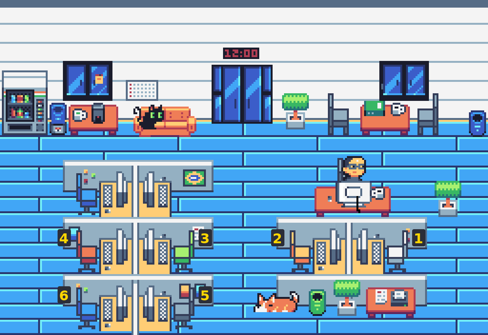
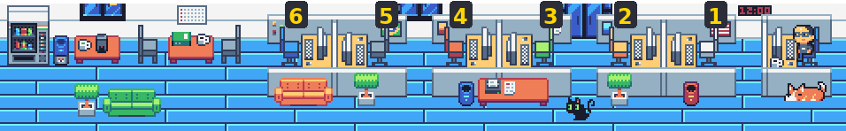

# My Office

[](https://github.com/marcelomogami/my-office/actions/workflows/tests.yml)

*[Leia isto em português](README.pt-BR.md)*

**A pixel-art office for keeping an eye on Claude Code and Codex sessions.** Each session appears as a character, with a bubble showing whether it is working, finished, encountered an error, or reached its quota.



My Office is a local, read-only display. It does not control agents or read conversation contents. Hooks send session metadata to a Node backend, which updates the interfaces. The image above uses example sessions.

## Choose your office

| Interface | How it works |
|---|---|
| **Web page** | A PixiJS room with six workstations, rest areas, and a session list. |
| **Kitty dock** | A compact room at the bottom of the terminal, visible across tabs, with a list with the Boss and up to eight sessions. |

Both interfaces can run at the same time and share the same backend. Kitty is optional for the web page.

## Get started

You need Node.js 20.19 or later in the 20.x series, or 22.12 or later, and npm. To try the web page with example sessions:

```sh
npm install
npm run dev
```

Open **http://127.0.0.1:5199/?demo**. The demo uses example sessions; configure your agent's hooks to display real sessions.

> The development server uses port 5199. If the My Office service is already using that port, stop `my-office.socket` and `my-office.service` before starting development, and start the socket again when finished.

To build the production web page and start the backend:

```sh
npm run build
npm start
```

The backend defaults to `127.0.0.1:5199`. Override the host and port with `MY_OFFICE_HOST` and `MY_OFFICE_PORT`; the event API only accepts connections from the local machine.

## Connect your agents

The scripts [`tools/hook.sh`](tools/hook.sh) and [`tools/codex-hook.sh`](tools/codex-hook.sh) receive events from Claude Code and Codex, respectively. They send only the metadata needed to identify the session and its status, without prompts, responses, or tool contents.

**[Install, trust, and test the hooks](documentation/hooks.md)**, with `tools/install-hooks.sh` or by hand

Codex model failures appear as errors, and a subsequent attempt returns the session to working. When the failure message is one of the messages Codex uses for exhausted usage (usage limit, quota, credits, spend cap), the session shows its quota instead; this relies on Codex's English messages, read locally and never sent.

## Use the Kitty dock

The dock requires Python 3, Pillow, and a Kitty version with `os-window-dock` and graphics protocol support. It was tested with Kitty 0.51.0. The backend must be running or available through its socket.

**[Configure and use the Kitty dock](documentation/kitty.md)**

## Session behavior

Bubbles show working, finished, error, or quota. A session with a workstation moves to a rest area after **10 minutes** without a new task, whether it finished, failed, or reached its quota. It gets a random free rest spot and keeps it until the rest ends: the web page has seven (standing in the kitchen, on the sofa, and at the meeting table) and the Kitty dock has eight. After **4 hours** without activity, it leaves the room and frees its workstation; after **8 hours**, it also leaves the list. A closed session leaves the room at once and stays in the list as away for 8 hours; a new session in the same project replaces it. Sessions without a workstation appear as home office and leave the list after **1 hour** without activity.

In the session cards, a colored dot between the face and the name shows the session's agent: orange for Claude Code and green for Codex; the web page tooltip shows the agent's name next to it. The colors live in [`src/harnesses.json`](src/harnesses.json), read by both the web page and the dock.

If the connection to the backend is lost for more than 10 seconds, the web page and the dock show a large "disconnected" stamp over the room: what you see may be out of date. The warning clears when the connection returns.

Characters come from a sprite sheet and catalog that you can extend or replace with your own, outside the repository: see **[Characters](documentation/characters.md)**. The other sprite sheets, the room layout and how to edit the drawings are in **[Assets](documentation/assets.md)**.

## Fixed projects

Each session is named after its project: the folder right below a family folder in `~/projects` (for example, `~/projects/work/my-api/src` is `my-api`), or the name of the folder itself outside `~/projects`. Other sessions get a random character, which they keep while it is free.

To give a project its own character or desk, create `config.json` in `~/.config/my-office/` (or in `MY_OFFICE_CONFIG_DIR`), the same folder as the custom characters. Use [`config.example.json`](config.example.json) as a starting point:

```json
{
  "projects": {
    "my-api": {"character": "char2", "desk": 1},
    "website": {"character": "char4", "desk": 2},
    "notes": {"character": "char6"}
  }
}
```

- `character`: the `id` of a default or custom character. No other session gets it, even while the project is closed.
- `desk`: a desk number from 1 to 6, the same in the web page and in the Kitty dock. Other sessions borrow it only when no other desk is free, and give it back when the project opens.
- Both are optional. An unknown character or desk, or one assigned to two projects, is ignored with a message in the backend log.

Desks are numbered from the Boss, right to left and top to bottom:





The backend reads `config.json` when it starts; restart it after a change.

## Language

The interface is in English by default. For another language, set `language` in the same `config.json`:

```json
{
  "language": "pt-BR",
  "projects": {}
}
```

The available languages are `en` and `pt-BR` (case-insensitive). Translations live in [`src/locales.json`](src/locales.json), read by both the web page and the dock; a string missing in a language shows in English. After changing the language, restart the backend and reopen the dock.

## Development

To contribute, see **[CONTRIBUTING.md](CONTRIBUTING.md)**.

Tests run automatically on GitHub Actions for every push and pull request ([`.github/workflows/tests.yml`](.github/workflows/tests.yml)). To run them locally:

```sh
npm test                                                   # backend and integration tests
python3 -m unittest discover -s tools/dock -p 'test_*.py' # dock tests
```

The backend exposes `POST /api/evento` for local metadata and `GET /api/stream` to broadcast the session list. Sessions and remembered positions are stored in `~/.local/state/my-office/`, or under the directory specified by `XDG_STATE_HOME`.

The units in [`deploy/`](deploy/) show a user service with socket activation. Update the project path in `deploy/my-office.service` if the repository is elsewhere. See the [changelog](CHANGELOG.md) for release history.

## License

The code is licensed under the [GNU General Public License v3.0 or later](LICENSE). The artwork created for My Office is licensed under [CC BY 4.0](https://creativecommons.org/licenses/by/4.0/); see [`assets/LICENSE.md`](assets/LICENSE.md).

## Credits

The sprites are based on the [Pixel Office Asset Pack by 2dPig](https://2dpig.itch.io/pixel-office), released under [CC0](https://creativecommons.org/publicdomain/zero/1.0/). The sheet includes adaptations and additional artwork created for My Office.
