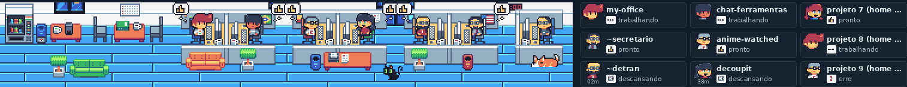
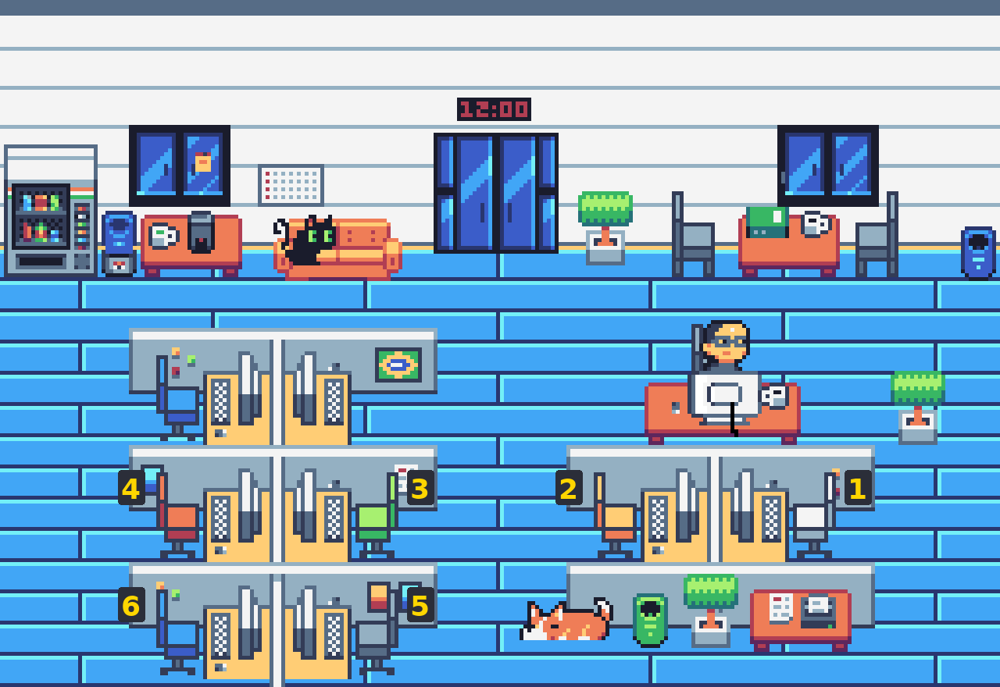
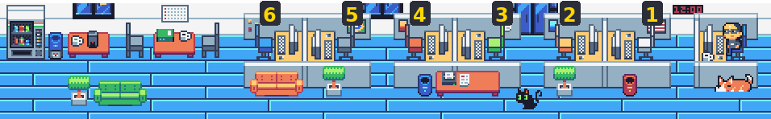

# My Office

[](https://github.com/marcelomogami/my-office/actions/workflows/tests.yml)

*[Read this in English](README.md)*

**Um escritório em pixel art para acompanhar sessões do Claude Code e do Codex.** Cada sessão aparece como um personagem, com um balão que indica quando está trabalhando, terminou, encontrou um erro ou atingiu a cota.



O projeto é uma visualização local: não controla os agentes nem lê o conteúdo das conversas. Os hooks enviam metadados a um backend em Node, que atualiza as interfaces. A imagem acima usa sessões de exemplo.

## Escolha seu escritório

| Interface | Como funciona |
|---|---|
| **Página web** | Sala em PixiJS com seis baias, áreas de descanso e lista de sessões. |
| **Dock do Kitty** | Sala compacta no rodapé do terminal, visível ao trocar de aba, com lista com o Boss e até oito sessões. |

As duas interfaces podem ficar abertas ao mesmo tempo e usam o mesmo backend. O Kitty é opcional para quem usa a página web.

## Começar

Você precisa de Node.js 20.19 ou superior na série 20, ou 22.12 ou superior, e npm. Para testar a página em modo de demonstração:

```sh
npm install
npm run dev
```

Abra **http://127.0.0.1:5199/?demo**. A demonstração usa sessões de exemplo; para mostrar sessões reais, configure os hooks do agente.

> O servidor de desenvolvimento usa a porta 5199. Se o serviço do my-office já estiver ativo nessa porta, pare `my-office.socket` e `my-office.service` antes de iniciar o desenvolvimento e volte a iniciar o socket ao terminar.

Para gerar a versão web de produção e iniciar o backend:

```sh
npm run build
npm start
```

O backend usa `127.0.0.1:5199` por padrão. O host e a porta podem ser alterados com `MY_OFFICE_HOST` e `MY_OFFICE_PORT`; a API de eventos aceita apenas conexões da própria máquina.

## Conectar os agentes

Os scripts [`tools/hook.sh`](tools/hook.sh) e [`tools/codex-hook.sh`](tools/codex-hook.sh) recebem os eventos do Claude Code e do Codex, respectivamente. Eles enviam somente metadados necessários à identificação da sessão e ao status, sem prompt, resposta ou conteúdo de ferramenta.

**[Como instalar, confiar e testar os hooks](documentation/hooks.pt-BR.md)**, com `tools/install-hooks.sh` ou à mão

A integração do Codex identifica falhas de modelo como erro e volta ao estado de trabalho em uma nova tentativa. Quando a mensagem da falha é uma das que o Codex usa para uso esgotado (limite de uso, cota, créditos, teto de gasto), a sessão mostra a cota; isso depende das mensagens em inglês do Codex, lidas localmente e nunca enviadas.

## Usar no Kitty

O dock precisa de Python 3, Pillow e uma versão do Kitty com `os-window-dock` e suporte ao protocolo gráfico. Foi testado no Kitty 0.51.0. O backend precisa estar ativo ou disponível por socket.

**[Como configurar e usar o dock do Kitty](documentation/kitty.pt-BR.md)**

## Como as sessões aparecem

Os balões mostram trabalho, conclusão, erro ou cota. Depois de **10 minutos** sem nova tarefa, uma sessão com baia vai descansar, tenha terminado, dado erro ou atingido a cota. Ela ganha um lugar de descanso livre sorteado e, a cada 15 a 20 minutos, muda para outro lugar livre. A página web tem sete lugares (em pé na copa, no sofá e na mesa de reunião) e o dock do Kitty tem oito. Após **4 horas** sem atividade, sai da sala e libera a baia; após **8 horas**, sai também da lista. Uma sessão fechada sai da sala na hora e continua na lista como "foi embora" por 8 horas; uma sessão nova no mesmo projeto toma o lugar dela. Sessões sem baia aparecem como home office e saem da lista após **1 hora** sem atividade. Esses tempos podem ser mudados: veja [Tempos](#tempos).

Nos cartões da lista, uma bolinha colorida entre o rosto e o nome indica o agente da sessão: laranja para o Claude Code e verde para o Codex; o tooltip da página mostra o nome do agente ao lado dela. As cores ficam em [`src/harnesses.json`](src/harnesses.json), lido pela página web e pelo dock.

Se a conexão com o backend cair por mais de 10 segundos, a página e o dock mostram um carimbo grande de "desconectado" sobre a sala: o que aparece pode estar desatualizado. O aviso some quando a conexão volta.

Os personagens vêm de uma folha de sprites com catálogo, que você pode ampliar ou substituir pelos seus, fora do repositório: veja **[Personagens](documentation/characters.pt-BR.md)**. As demais folhas de sprites, a disposição da sala e como editar os desenhos estão em **[Assets](documentation/assets.pt-BR.md)**.

## Projetos fixos

Cada sessão leva o nome do seu projeto: a pasta logo abaixo de uma pasta de família em `~/projects` (por exemplo, `~/projects/work/my-api/src` é `my-api`) ou, fora de `~/projects`, o nome da própria pasta. As demais sessões ganham um personagem sorteado, que mantêm enquanto ele estiver livre.

Para dar a um projeto um personagem ou uma baia própria, crie o `config.json` em `~/.config/my-office/` (ou em `MY_OFFICE_CONFIG_DIR`), a mesma pasta dos personagens custom. Use o [`config.example.json`](config.example.json) como ponto de partida:

```json
{
  "projects": {
    "my-api": {"character": "char2", "desk": 1},
    "website": {"character": "char4", "desk": 2},
    "notes": {"character": "char6"}
  }
}
```

- `character`: o `id` de um personagem padrão ou custom. Nenhuma outra sessão o recebe, nem com o projeto fechado.
- `desk`: o número da baia, de 1 a 6, o mesmo na página web e no dock do Kitty. Outras sessões só a pegam emprestada quando não há outra baia livre, e a devolvem quando o projeto abre.
- Os dois são opcionais. Personagem ou baia desconhecidos, ou atribuídos a dois projetos, são ignorados com uma mensagem no log do backend.

As baias são numeradas a partir do Boss, da direita para a esquerda e de cima para baixo:





O backend lê o `config.json` ao iniciar; reinicie-o depois de uma mudança.

## Tempos

Os tempos do ciclo das sessões têm padrões no My Office e podem ser trocados em `timers`, no mesmo `config.json`, em minutos. Use só os que quiser mudar; os outros ficam no padrão:

```json
{
  "timers": {"rest": 10, "leaveRoom": 240, "leaveList": 480, "homeOfficeLeaveList": 60, "restMove": 15}
}
```

| Tempo | Padrão | O que faz |
|---|---|---|
| `rest` | 10 | Sem nova tarefa (pronto, erro ou cota), a sessão vai descansar. |
| `leaveRoom` | 240 | Sem atividade, a sessão sai da sala e libera a baia. |
| `leaveList` | 480 | A sessão fechada ou fora da sala sai também da lista. |
| `homeOfficeLeaveList` | 60 | A sessão em home office sai da lista. |
| `restMove` | 15 | Quem está descansando troca de lugar, num tempo sorteado entre o valor e um terço a mais (15 a 20 minutos), contado a partir de quando entrou em descanso. `0` desliga. |

A ordem do ciclo é fixa: descansar, sair da sala, sair da lista. Um valor que a quebre, ou que não seja um número válido, é ignorado com uma mensagem no log do backend, e o padrão vale no lugar dele.

## Idioma

A interface aparece em inglês por padrão. Para outro idioma, use `language` no mesmo `config.json`:

```json
{
  "language": "pt-BR",
  "projects": {}
}
```

Os idiomas disponíveis são `en` e `pt-BR` (sem diferenciar maiúsculas). As traduções ficam em [`src/locales.json`](src/locales.json), lido pela página web e pelo dock; um texto que falte num idioma aparece em inglês. Depois de mudar o idioma, reinicie o backend e reabra o dock.

## Desenvolvimento

Para contribuir, veja **[CONTRIBUTING.pt-BR.md](CONTRIBUTING.pt-BR.md)**.

Os testes rodam automaticamente no GitHub Actions a cada push e pull request ([`.github/workflows/tests.yml`](.github/workflows/tests.yml)). Para rodar localmente:

```sh
npm test                                             # testes do backend e da integração
python3 -m unittest discover -s tools/dock -p 'test_*.py'  # testes do dock
```

O backend expõe `POST /api/evento` para receber metadados locais e `GET /api/stream` para transmitir a lista de sessões. As sessões e os lugares lembrados ficam em `~/.local/state/my-office/`, ou no diretório definido por `XDG_STATE_HOME`.

As units em [`deploy/`](deploy/) mostram a configuração do serviço de usuário com ativação por socket. O caminho do projeto em `deploy/my-office.service` precisa ser ajustado se o repositório estiver em outro local. O histórico de versões está no [changelog](CHANGELOG.md).

## Licença

O código é licenciado sob a [GNU General Public License v3.0 ou posterior](LICENSE). A arte criada para o My Office é licenciada sob [CC BY 4.0](https://creativecommons.org/licenses/by/4.0/deed.pt-br); veja [`assets/LICENSE.md`](assets/LICENSE.md).

## Créditos

Os sprites são baseados no [Pixel Office Asset Pack, de 2dPig](https://2dpig.itch.io/pixel-office), distribuído sob [CC0](https://creativecommons.org/publicdomain/zero/1.0/). A folha inclui adaptações e desenhos adicionais feitos para o My Office.
