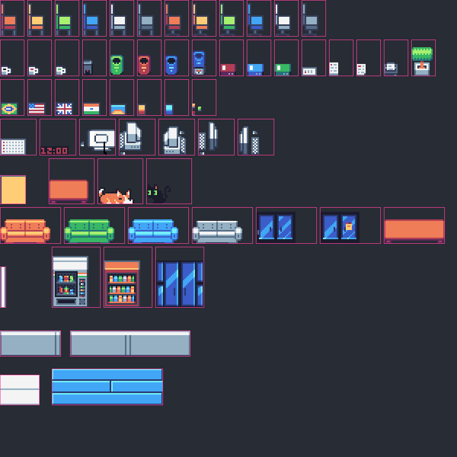
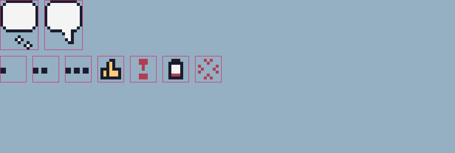

# Assets

*[Leia isto em português](assets.pt-BR.md)*

This guide explains how the project's sprite sheets work, how objects are placed in the web office and in the Kitty dock, and how to draw or replace a sprite. Characters have their own guide, with the cell size, the hip and feet lines and the face crop: see **[Characters](characters.md)**.

## Files

Each sheet lives in its own folder under `assets/`, with three files:

| Folder | Contents | Sheet size |
|---|---|---|
| `assets/office/` | furniture, objects, wall and floor | 300 × 300 |
| `assets/ui/` | status bubbles and icons | 154 × 52 |
| `assets/characters/` | default characters ([own guide](characters.md)) | 322 × 26 |

- `default.aseprite`: the source file, edited in Aseprite.
- `default.png`: the exported sheet, read by the web page and the dock.
- `default.json`: the map, with the name and rectangle of each sprite.

`assets/pixel-office-2dpig/` keeps the original 2dPig pack (`PixelOffice.zip` and the files extracted from it), unchanged, for reference only. Nothing is read from that folder.

Credits and licenses are in [`assets/LICENSE.md`](../assets/LICENSE.md): the original pack is CC0, and what was added or adapted for the project is CC BY 4.0.

## How it works

Sheets are drawn and exported at **1x**: one sheet pixel is one scene pixel. Scaling happens when drawing: the web page scales the sheet 5 times when loading it, without smoothing, and the dock scales the finished image 2 times.

Each sprite is mapped by its **full cell**, not by the outline of the drawing. In the map, a sprite is `[x, y, width, height]`, in sheet pixels:

```json
{
  "sheet": "default.png",
  "gap": 2,
  "items": {
    "chair0": [0, 0, 16, 24],
    "desk": [0, 115, 17, 19]
  }
}
```

Cells are separated by **2 transparent pixels**, horizontally and vertically (`gap`). Each sprite is cropped by its exact rectangle, so anything outside the cell does not show.

Positions in the room refer to the **top-left corner of the cell**. A drawing can use any part of its cell, but a new or replacement drawing must keep the original alignment: an object resting on the floor touches the bottom of the cell, and a picture on the wall stays at the same height. If the drawing moves inside the cell, it moves in the room.

## Custom sheets

You can replace sprites without touching the repository. As with characters, custom sheets live in the local configuration folder, `~/.config/my-office` (or the folder in `MY_OFFICE_CONFIG_DIR`), which never goes into the repository:

| Sheet | Custom map and sheet |
|---|---|
| Objects | `~/.config/my-office/office/custom.json` + `custom.png` |
| Bubbles and icons | `~/.config/my-office/ui/custom.json` + `custom.png` |
| Characters | `~/.config/my-office/characters/custom.json` + `custom.png` ([own guide](characters.md)) |

The custom sheet is layered over the default one **sprite by sprite, by name**:

- a sprite with the same name as a default sprite replaces it;
- anything not in the custom map still comes from the default sheet, so the custom map only needs what changes;
- **objects:** only names that already exist in the default map are accepted. The room layout belongs to the project, so furniture with a new name would have nowhere to appear;
- **bubbles and icons:** new names are accepted too, to add emotes to the system. For now they are only loaded: a sprite shows up when something uses it by name, and the boss emotes are not implemented yet.

The custom map uses the same format as the default one, and positions refer to the custom sheet:

```json
{
  "sheet": "custom.png",
  "items": {
    "plant": [0, 0, 16, 24],
    "iconDone": [18, 0, 9, 9]
  }
}
```

The custom sheet can have any size and layout. Each sprite, however, must have the same cell as the sprite it replaces, with the drawing aligned the same way, because its position in the room is still the default one. A simple way to start is to copy the default sheet, redraw only the cells you want to change, and map only those cells in `custom.json`.

Invalid entries (an unknown object name, a malformed rectangle) are ignored, with a warning in the backend log. Without `custom.json` or without the sheet, nothing changes. The backend and the dock read the sheets when they start: after changing a custom sheet, restart the service (`systemctl --user restart my-office.service`) and reopen the dock.

## Objects (`assets/office/`)



Each row of the sheet groups cells of the same size:

| Cell | Sprites |
|---|---|
| 16 × 24 | `chair0` to `chair5`, `officeOrange`, `officeYellow`, `officeGreen`, `officeBlue`, `officeWhite`, `officeGrey` |
| 16 × 24 | `mugCoffee`, `mugRed`, `mug`, `coffee`, `binGreen`, `binRed`, `binBlue`, `cooler`, `boxRed`, `boxBlue`, `boxGreen`, `boxTop`, `doc2`, `doc1`, `printer`, `plant` |
| 16 × 24 | `flagBR`, `flagUS`, `flagUK`, `flagIN`, `painting`, `posterSun`, `posterBlue`, `stickies` |
| 24 × 24 | `calendar`, `clock`, `computerBack`, `computerFront1`, `computerFront2`, `computerSide1`, `computerSide2` |
| 30 × 30 | `tableSmall`, `dog`, `cat` |
| 17 × 19 | `desk` |
| 40 × 24 | `sofaOrange`, `sofaGreen`, `sofaBlue`, `sofaGrey`, `window`, `windowNote`, `tableLong` |
| 32 × 40 | `vending`, `fridge`, `door` |
| 4 × 27 | `divider` |
| 40 × 17 | `partitionSingle` |
| 79 × 17 | `partition` |
| 73 × 24 | `floor` |
| 26 × 20 | `wall` |

The exact position of each cell is in `assets/office/default.json`.

Computers are complete sets, with monitor, keyboard and mouse in the same cell: `computerSide1` and `computerSide2` at the desks, `computerBack` on the Boss desk.

### Wall and floor

The wall and the floor are also sprites from the sheet, repeated to cover the room:

- **`wall`:** 26 × 20, white, with a stripe every 10 rows (the 10th and the 20th). It is repeated upwards from the floor, so the last stripe sits right above it.
- **`floor`:** 73 × 24, with three 8-row bands of bricks. The pattern repeats every two bands, so the sprite is repeated every 16 rows: the third band of one tile matches the first band of the next.

In the web page, `"background"` in `src/scene.json` sets the row where the floor starts (`floorY`) and the horizontal offset of the bricks (`floorX`). In the dock, the same values are `FLOOR_Y` and `FLOOR_X` in `tools/dock/office.py`.

## Bubbles and icons (`assets/ui/`)



| Cell | Sprites |
|---|---|
| 13 × 17 | `bubbleThought` (the bubble in use), `bubbleSpeech` |
| 9 × 9 | `iconWork1`, `iconWork2`, `iconWork3`, `iconDone`, `iconError`, `iconQuota`, `iconAnger` |

The thought bubble has its dots going down to the right. The icon is drawn on top, 2 pixels right and 1 down from the bubble corner, and fits inside it with 1 pixel to spare before the border.

Each session status picks its icon in `src/status.js` (web) and in `STATUSES` (`tools/dock/office.py`). A list of icons becomes an animation, like `iconWork1` to `iconWork3` for "working".

**Bubble placement:**

- **Web page:** the bubble sits in the aisle next to the character, at the x given by each desk's `bubbleX` (`src/scene.json`), 10 rows above the top of the character. The Boss has its own `bubbleX` and vertical offset, in `MANAGER` (`src/main.js`).
- **Dock:** one rule for the three pairs of desks: the left desk's bubble sits 5 pixels before the pair starts and the right desk's bubble 68 pixels after. Both are symmetric around the center of the pair. The height is 8 rows above the top of the character, without going past the top edge of the image.

When the bubble is to the right of the character, it is mirrored so the dots point to the head. The icon is never mirrored.

**Adding an icon:** draw a 9 × 9 cell in the icon row of the interface sheet, map it in `assets/ui/default.json` and use its name in the status, in `src/status.js` and in the dock's `STATUSES`. To change an icon's drawing without touching the repository, use the [custom](#custom-sheets) interface sheet.

## Room layout

### Web page

`src/scene.json` describes the whole room:

- **`crop`:** the part of the scene that is shown, in 1x pixels.
- **`background`:** where the floor starts and the brick offset (see [Wall and floor](#wall-and-floor)).
- **`items`:** the list of objects, `[name, x, y]`, or `[name, x, y, 1]` to mirror. **List order is draw order**: later items are drawn in front.
- **`seats`:** the desks, with the chair, mirroring, mug and the bubble's `bubbleX`.
- **`rest`:** the rest spots, standing (`stand`) or seated (`chair`).

Some entries in `items` are not sprites but markers for the point in the draw order where something goes:

- **`seat:X`:** the character seated at desk X (after the chair and desk, before the computer);
- **`cup:X`:** the mug of desk X, shown only while the desk is taken;
- **`rest:X`:** whoever sits at rest spot X.

Desks and rest spots are numbered from the Boss, right to left and top to bottom. To place a seated character, the scene uses the chair corner; the fitting rule is in the [characters guide](characters.md).

### Kitty dock

The dock has its own room, wider and shorter, described in `tools/dock/office.py`. The three pairs of desks repeat from each pair's x (`PAIR`), the rest spots are in `REST`, and the other objects are placed directly in `render()`, also in draw order.

## Editing the sprites

### Editors

The project sheets are edited in [Aseprite](https://www.aseprite.org/) (paid; Windows, macOS and Linux), and the `.aseprite` files are kept in the repository. Free editors that read and write PNG with transparency, such as [LibreSprite](https://libresprite.github.io/) and [Pixelorama](https://pixelorama.org/), also work for editing the PNG, but the `.aseprite` files may not open in all of them.

### Settings

- 1x scale.
- Pencil without antialiasing.
- Transparent background.
- PNG export without scaling or color changes.
- 2 transparent pixels between sprites, horizontally and vertically.

The `.aseprite` files have a `separators` layer that marks the cells and the 2-pixel spacing. It is hidden before exporting. Guide lines left in the PNG do not affect the offices, since each sprite is cropped by its exact rectangle, but they get in the way of automatically detecting new sprites in a new export.

### Replacing or adding a sprite

1. Draw on the sheet. To replace, use the same cell and keep the original alignment; to add, use a free cell with 2 pixels of space to its neighbors.
2. Hide the `separators` layer and export the PNG over `default.png`.
3. For a new sprite, add its name and cell rectangle to the folder's `default.json`.
4. To use it, add it to `items` in `src/scene.json` (web) and to `tools/dock/office.py` (dock).

### Checking the result

- **Web page:** `npm run dev` and open the page with `?demo`. `?demo&descanso` puts a character in every rest spot, and `?demo&ciclo` cycles the statuses. Without a browser, `python3 tools/compose_scene.py /tmp/room.png` renders the room.
- **Dock:** `python3 tools/dock/office.py --png /tmp/dock.png` renders an empty frame. In a Kitty tab, `--descanso` puts a character in every rest spot and `--baias` one in every desk, with bubbles; both refresh by themselves when the dock code changes.

After changing a sheet, the page served by the service only changes after `npm run build`, and the dock has to be reopened.
