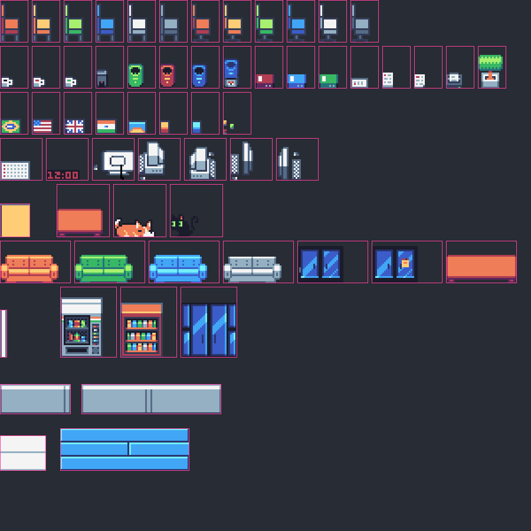
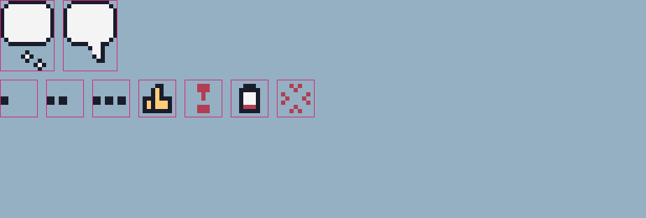

# Assets

*[Read this in English](assets.md)*

Este guia explica como funcionam as folhas de sprites do projeto, como os objetos são posicionados na página web e no dock do Kitty, e como desenhar ou trocar um sprite. Os personagens têm guia próprio, com o tamanho da célula, as linhas do quadril e dos pés e o recorte do rosto: veja **[Personagens](characters.pt-BR.md)**.

## Arquivos

Cada folha fica numa pasta própria de `assets/`, com três arquivos:

| Pasta | Conteúdo | Tamanho da folha |
|---|---|---|
| `assets/office/` | móveis, objetos, parede e piso | 300 × 300 |
| `assets/ui/` | balões e ícones de status | 154 × 52 |
| `assets/characters/` | personagens padrão ([guia próprio](characters.pt-BR.md)) | 322 × 26 |

- `default.aseprite`: o arquivo-fonte, editado no Aseprite.
- `default.png`: a folha exportada, que a página e o dock leem.
- `default.json`: o mapa, com o nome e o retângulo de cada sprite.

`assets/pixel-office-2dpig/` guarda o pacote original do 2dPig (`PixelOffice.zip` e os arquivos extraídos dele), sem alterações, só como referência. Nada é lido dessa pasta.

Os créditos e as licenças estão em [`assets/LICENSE.md`](../assets/LICENSE.md): o pacote original é CC0 e o que foi acrescentado ou adaptado para o projeto é CC BY 4.0.

## Como funciona

As folhas são desenhadas e exportadas em **1x**: um pixel da folha é um pixel da cena. Quem amplia é quem desenha: a página web amplia 5 vezes ao carregar a folha, sem suavização, e o dock amplia a imagem pronta 2 vezes.

Cada sprite é mapeado pela **célula inteira**, não pelo contorno do desenho. No mapa, o sprite é `[x, y, largura, altura]`, em pixels da folha:

```json
{
  "sheet": "default.png",
  "gap": 2,
  "items": {
    "chair0": [0, 0, 16, 24],
    "desk": [0, 115, 17, 19]
  }
}
```

Entre uma célula e outra há **2 pixels transparentes**, na horizontal e na vertical (`gap`). Cada sprite é recortado pelo seu retângulo exato, então o que estiver fora da célula não aparece.

As posições na sala se referem ao **canto superior esquerdo da célula**. Por isso o desenho pode usar qualquer parte da célula, mas um desenho novo ou trocado precisa manter o mesmo alinhamento do original: um objeto apoiado no chão encosta na base da célula, e um quadro na parede fica na mesma altura. Se o desenho mudar de lugar dentro da célula, ele muda de lugar na sala.

## Folhas custom

Você pode trocar sprites das folhas sem mexer no repositório. Como nos personagens, as folhas custom ficam na pasta de configuração local, `~/.config/my-office` (ou a pasta de `MY_OFFICE_CONFIG_DIR`), que nunca vai para o repositório:

| Folha | Mapa e folha custom |
|---|---|
| Objetos | `~/.config/my-office/office/custom.json` + `custom.png` |
| Balões e ícones | `~/.config/my-office/ui/custom.json` + `custom.png` |
| Personagens | `~/.config/my-office/characters/custom.json` + `custom.png` ([guia próprio](characters.pt-BR.md)) |

O custom se sobrepõe ao padrão **sprite a sprite, pelo nome**:

- um sprite com o mesmo nome de um sprite padrão o substitui;
- o que não estiver no mapa custom continua vindo da folha padrão, então o custom só precisa ter o que muda;
- **objetos:** só valem nomes que já existem no mapa padrão. A disposição da sala é a do projeto, então um móvel com nome novo não teria onde aparecer;
- **balões e ícones:** nomes novos também são aceitos, para acrescentar emotes ao sistema. Por enquanto eles só ficam carregados: um sprite aparece quando algo o usa pelo nome, e os emotes do Boss ainda não foram implementados.

O mapa custom tem o mesmo formato do padrão, e as posições se referem à folha custom:

```json
{
  "sheet": "custom.png",
  "items": {
    "plant": [0, 0, 16, 24],
    "iconDone": [18, 0, 9, 9]
  }
}
```

A folha custom pode ter qualquer tamanho e disposição. Cada sprite, porém, precisa ter a mesma célula do sprite que substitui, com o desenho alinhado do mesmo jeito, porque a posição na sala continua a do padrão. Um jeito simples de começar é copiar a folha padrão e redesenhar só as células que você quer trocar, mapeando no `custom.json` só essas células.

Entradas inválidas (nome desconhecido nos objetos, retângulo malformado) são ignoradas, com um aviso no log do backend. Sem o `custom.json` ou sem a folha, nada muda. O backend e o dock leem as folhas ao iniciar: depois de mudar uma folha custom, reinicie o serviço (`systemctl --user restart my-office.service`) e reabra o dock.

## Objetos (`assets/office/`)



Cada linha da folha agrupa células do mesmo tamanho:

| Célula | Sprites |
|---|---|
| 16 × 24 | `chair0` a `chair5`, `officeOrange`, `officeYellow`, `officeGreen`, `officeBlue`, `officeWhite`, `officeGrey` |
| 16 × 24 | `mugCoffee`, `mugRed`, `mug`, `coffee`, `binGreen`, `binRed`, `binBlue`, `cooler`, `boxRed`, `boxBlue`, `boxGreen`, `boxTop`, `doc2`, `doc1`, `printer`, `plant` |
| 16 × 24 | `flagBR`, `flagUS`, `flagUK`, `flagIN`, `painting`, `posterSun`, `posterBlue`, `stickies` |
| 24 × 24 | `calendar`, `clock`, `computerBack`, `computerFront1`, `computerFront2`, `computerSide1`, `computerSide2` |
| 30 × 30 | `tableSmall`, `dog`, `cat` |
| 17 × 19 | `desk` |
| 40 × 24 | `sofaOrange`, `sofaGreen`, `sofaBlue`, `sofaGrey`, `window`, `windowNote`, `tableLong` |
| 32 × 40 | `vending`, `fridge`, `door` |
| 4 × 27 | `divider` |
| 40 × 17 | `partitionSingle` |
| 79 × 17 | `partition` |
| 73 × 24 | `floor` |
| 26 × 20 | `wall` |

As posições exatas de cada célula estão em `assets/office/default.json`.

Os computadores são conjuntos completos, com monitor, teclado e mouse na mesma célula: `computerSide1` e `computerSide2` nas baias, `computerBack` na mesa do Boss.

### Parede e piso

A parede e o piso também são sprites da folha, repetidos para cobrir a sala:

- **`wall`:** 26 × 20, branca, com uma listra a cada 10 linhas (na 10ª e na 20ª). Ela é repetida de baixo para cima, a partir do piso, então a última listra fica logo acima dele.
- **`floor`:** 73 × 24, com três faixas de tijolos de 8 linhas. O desenho se repete a cada duas faixas, então o sprite é repetido de 16 em 16 linhas: a terceira faixa de uma peça coincide com a primeira da seguinte.

Na página web, `"background"` em `src/scene.json` define a linha onde o piso começa (`floorY`) e o deslocamento horizontal dos tijolos (`floorX`). No dock, os mesmos valores estão em `FLOOR_Y` e `FLOOR_X`, em `tools/dock/office.py`.

## Balões e ícones (`assets/ui/`)



| Célula | Sprites |
|---|---|
| 13 × 17 | `bubbleThought` (o balão usado), `bubbleSpeech` |
| 9 × 9 | `iconWork1`, `iconWork2`, `iconWork3`, `iconDone`, `iconError`, `iconQuota`, `iconAnger` |

O balão de pensamento tem as bolinhas descendo para a direita. O ícone é desenhado por cima, 2 pixels à direita e 1 abaixo do canto do balão, e cabe na parte de dentro, com 1 pixel de folga até a borda.

O status de cada sessão escolhe o ícone em `src/status.js` (web) e em `STATUSES` (`tools/dock/office.py`). Uma lista de ícones vira animação, como `iconWork1` a `iconWork3` em "trabalhando".

**Posição do balão:**

- **Página web:** o balão fica no corredor ao lado do personagem, no x definido em `bubbleX` de cada baia (`src/scene.json`), 10 linhas acima do topo do personagem. O Boss usa `bubbleX` e um ajuste vertical próprio, em `MANAGER` (`src/main.js`).
- **Dock:** uma regra só, para os três pares de baias: o balão da baia da esquerda fica 5 pixels antes do começo do par e o da direita, 68 pixels depois. Os dois ficam simétricos em relação ao centro do par. A altura é 8 linhas acima do topo do personagem, sem passar da borda de cima da imagem.

Quando o balão fica à direita do personagem, ele é espelhado para as bolinhas apontarem para a cabeça. O ícone nunca é espelhado.

**Acrescentar um ícone:** desenhe uma célula de 9 × 9 na linha de ícones da folha de interface, mapeie-a em `assets/ui/default.json` e use o nome dela no status, em `src/status.js` e em `STATUSES` do dock. Para trocar o desenho de um ícone sem mexer no repositório, use a [folha custom](#folhas-custom) de interface.

## Disposição da sala

### Página web

`src/scene.json` descreve a sala inteira:

- **`crop`:** a parte da cena mostrada, em pixels 1x.
- **`background`:** onde começa o piso e o deslocamento dos tijolos (veja [Parede e piso](#parede-e-piso)).
- **`items`:** a lista de objetos, `[nome, x, y]` ou `[nome, x, y, 1]` para espelhar. **A ordem da lista é a ordem de desenho**: o que vem depois fica na frente.
- **`seats`:** as baias, com a cadeira, o espelhamento, a xícara e o `bubbleX` do balão.
- **`rest`:** os lugares de descanso, em pé (`stand`) ou sentados (`chair`).

Alguns itens de `items` não são sprites, mas marcadores do ponto da ordem de desenho em que algo entra:

- **`seat:X`:** o personagem sentado na baia X (depois da cadeira e da mesa, antes do computador);
- **`cup:X`:** a xícara da baia X, que só aparece com a baia ocupada;
- **`rest:X`:** quem senta no lugar de descanso X.

Baias e lugares de descanso são numerados a partir do Boss, da direita para a esquerda e de cima para baixo. Para posicionar um personagem sentado, a cena usa o canto da cadeira; a regra de encaixe está no [guia de personagens](characters.pt-BR.md).

### Dock do Kitty

O dock tem sua própria sala, mais larga e baixa, descrita em `tools/dock/office.py`. Os três pares de baias se repetem a partir do x de cada par (`PAIR`), os lugares de descanso estão em `REST`, e os demais objetos são posicionados diretamente em `render()`, também em ordem de desenho.

## Editar os sprites

### Editores

As folhas do projeto são editadas no [Aseprite](https://www.aseprite.org/) (pago; Windows, macOS e Linux), e os arquivos `.aseprite` ficam no repositório. Editores gratuitos que leem e gravam PNG com transparência, como o [LibreSprite](https://libresprite.github.io/) e o [Pixelorama](https://pixelorama.org/), também servem para editar o PNG, mas os arquivos `.aseprite` podem não abrir em todos eles.

### Configurações

- Escala 1x.
- Lápis sem suavização (antialiasing).
- Fundo transparente.
- Exportação em PNG sem ampliar e sem mudar as cores.
- 2 pixels transparentes entre os sprites, na horizontal e na vertical.

Os arquivos `.aseprite` têm uma camada `separators`, que marca as células e o espaçamento de 2 pixels. Ela fica escondida na hora de exportar. Linhas-guia que sobrarem no PNG não afetam os escritórios, porque cada sprite é recortado pelo seu retângulo exato, mas atrapalham a detecção automática de sprites novos numa exportação nova.

### Trocar ou acrescentar um sprite

1. Desenhe na folha. Para trocar, use a mesma célula e mantenha o alinhamento do original; para acrescentar, use uma célula livre, com 2 pixels de espaço até as vizinhas.
2. Esconda a camada `separators` e exporte o PNG por cima de `default.png`.
3. Para um sprite novo, acrescente o nome e o retângulo da célula no `default.json` da pasta.
4. Para usar o sprite, acrescente-o em `items` de `src/scene.json` (web) e em `tools/dock/office.py` (dock).

### Conferir o resultado

- **Página web:** `npm run dev` e abra a página com `?demo`. `?demo&descanso` põe um personagem em cada lugar de descanso, e `?demo&ciclo` faz os status girarem. Sem navegador, `python3 tools/compose_scene.py /tmp/sala.png` gera a imagem da sala.
- **Dock:** `python3 tools/dock/office.py --png /tmp/dock.png` gera um quadro vazio. Numa aba do Kitty, `--descanso` põe um personagem em cada lugar de descanso e `--baias` um em cada baia, com balões; os dois se atualizam sozinhos quando o código do dock muda.

Depois de trocar uma folha, a página só muda no serviço depois de `npm run build`, e o dock precisa ser reaberto.
