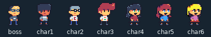

# Characters

*[Leia isto em português](characters.pt-BR.md)*

Characters live in their own sprite sheet, with a catalog file next to it. The web office and the Kitty dock read the same files.



## Default and custom characters

| | Sheet and catalog | Where |
|---|---|---|
| **Default** | `default.png` + `default.json` | `assets/characters/`, in the repository |
| **Custom** | `custom.png` + `custom.json` | `~/.config/my-office/characters/`, on your machine only |

Set `MY_OFFICE_CONFIG_DIR` to use another folder instead of `~/.config/my-office`. The custom folder is never part of the repository, so characters drawn for real people stay on your machine.

Custom characters are merged with the default ones by identifier:

- an entry with the same `id` as a default character replaces it;
- an entry with a new `id` is added to the characters available for sessions;
- the character with the `id` `boss` sits at the boss desk and is not given to sessions. A custom `boss` replaces the default one.

More characters do not add desks or rest areas: they only join the draw for the existing places. Use a prefix of your own for new identifiers (for example `custom1`), so a future default character does not replace yours by accident.

The backend and the dock read the catalogs when they start. Restart them after changing a sheet or a catalog.

## Sprite specification

All measurements are in 1x pixels.

- **Cell:** 21 × 24, followed by 2 transparent pixels to the right and below. Cells repeat every 23 pixels horizontally and 26 pixels vertically; the cell in column `c` and row `r` starts at `(23·c, 26·r)`.
- **Feet:** on the bottom row of the cell.
- **Hips:** 5 rows above the bottom (the belt or the top of a skirt). Legs and shoes take the 4 rows below.
- **Width:** center the body in the cell. Hair may extend to either side.
- **Height:** the cell has no room above 24 rows. Hair, hats and the like must fit inside it.

The hip and feet lines are what make one rule seat every character: the seated cell is placed 1 pixel left of and 4 pixels above the chair. A character drawn off these lines will float above the chair or sink into it.

### Poses

Each character has two poses, each in its own cell:

- **Seated:** facing the viewer, with the legs bent. **The chair seat must stay visible.** Clothing that falls over the lap (a skirt, a dress, a long coat) is cut at the hips in this pose, so the seat shows below it; do not move the drawing up instead.
- **Standing:** used in rest areas. Its top rows also provide the face shown in the session lists.

## Catalog

```json
{
  "sheet": "default.png",
  "cell": [21, 24],
  "gap": 2,
  "characters": [
    {"id": "boss", "seated": [0, 0], "standing": [1, 0], "face": [3, 3, 13, 14]},
    {"id": "char1", "seated": [2, 0], "standing": [3, 0], "face": [2, 1, 15, 14]}
  ]
}
```

- `sheet`: the PNG file, in the same folder as the catalog.
- `cell` and `gap`: cell size and spacing, in pixels.
- `id`: lowercase letters, digits and hyphens. It is how sessions, custom characters and configuration refer to the character, so keep it stable.
- `seated` and `standing`: the cell of each pose, as `[column, row]`. The layout of the sheet is free; only the cells listed in the catalog are used.
- `face`: the face crop inside the standing cell, as `[x, y, width, height]`. The lists use 14 rows from the top of the head.

## Adding a character

1. Draw both poses in free cells of the sheet, following the specification above, and export the PNG with transparency and no smoothing.
2. Add an entry to the catalog with the cells and the face crop.
3. Restart the backend (`systemctl --user restart my-office.service` for the user service) and the dock.
4. Check the result: open the web office with `?demo`, generate the dock image with `python3 tools/dock/office.py --png /tmp/dock.png`, and confirm that the seat shows under the seated pose and the face is centered in the list.
