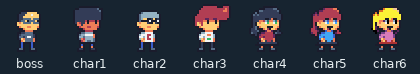

# Personagens

*[Read this in English](characters.md)*

Os personagens ficam numa folha de sprites própria, com um arquivo de catálogo ao lado. A página web e o dock do Kitty leem os mesmos arquivos. As demais folhas (objetos, balões e ícones) e a configuração do editor estão em **[Assets](assets.pt-BR.md)**.



## Personagens padrão e custom

| | Folha e catálogo | Onde |
|---|---|---|
| **Padrão** | `default.png` + `default.json` | `assets/characters/`, no repositório |
| **Custom** | `custom.png` + `custom.json` | `~/.config/my-office/characters/`, só na sua máquina |

Defina `MY_OFFICE_CONFIG_DIR` para usar outra pasta no lugar de `~/.config/my-office`. A pasta custom nunca faz parte do repositório, então personagens desenhados a partir de pessoas reais ficam só na sua máquina.

Os personagens custom se somam aos padrão pelo identificador:

- uma entrada com o mesmo `id` de um personagem padrão o substitui;
- uma entrada com `id` novo entra entre os personagens disponíveis para as sessões;
- o personagem com o `id` `boss` fica na mesa de chefe e não é dado às sessões. Um `boss` custom substitui o padrão.

Mais personagens não acrescentam baias nem áreas de descanso: eles só entram no sorteio dos lugares que já existem. Use um prefixo seu nos identificadores novos (por exemplo, `custom1`), para que um personagem padrão futuro não substitua o seu por engano.

O backend e o dock leem os catálogos ao iniciar. Reinicie os dois depois de mudar uma folha ou um catálogo.

## Especificação dos sprites

Todas as medidas são em pixels 1x.

- **Célula:** 21 × 24, seguida de 2 pixels transparentes à direita e embaixo. As células se repetem a cada 23 pixels na horizontal e 26 na vertical; a célula da coluna `c` e linha `l` começa em `(23·c, 26·l)`.
- **Pés:** na última linha da célula.
- **Quadril:** 5 linhas acima da base (o cinto ou o começo da saia). Pernas e sapatos ocupam as 4 linhas de baixo.
- **Largura:** centralize o corpo na célula. O cabelo pode sobrar para qualquer lado.
- **Altura:** não há folga acima das 24 linhas. Cabelo, chapéu e afins precisam caber na célula.

As linhas do quadril e dos pés é que permitem uma regra só para sentar todos os personagens: a célula sentada fica 1 pixel à esquerda e 4 pixels acima da cadeira. Um personagem desenhado fora dessas linhas flutua sobre a cadeira ou afunda nela.

### Poses

Cada personagem tem duas poses, cada uma na sua célula:

- **Sentado:** de frente, com as pernas dobradas. **O assento da cadeira precisa ficar visível.** Roupas que caem sobre o colo (saia, vestido, casaco longo) são cortadas no quadril nesta pose, para o assento aparecer abaixo; não suba o desenho no lugar disso.
- **Em pé:** usado nas áreas de descanso. As linhas de cima também fornecem o rosto mostrado nas listas de sessões.

## Catálogo

```json
{
  "sheet": "default.png",
  "cell": [21, 24],
  "gap": 2,
  "characters": [
    {"id": "boss", "seated": [0, 0], "standing": [1, 0], "face": [3, 3, 13, 14]},
    {"id": "char1", "seated": [2, 0], "standing": [3, 0], "face": [2, 1, 15, 14]}
  ]
}
```

- `sheet`: o arquivo PNG, na mesma pasta do catálogo.
- `cell` e `gap`: tamanho da célula e espaçamento, em pixels.
- `id`: letras minúsculas, números e hífen. É por ele que sessões, personagens custom e configurações se referem ao personagem, então mantenha-o estável.
- `seated` e `standing`: a célula de cada pose, em `[coluna, linha]`. A disposição da folha é livre; só as células citadas no catálogo são usadas.
- `face`: o recorte do rosto dentro da célula em pé, em `[x, y, largura, altura]`. As listas usam 14 linhas a partir do topo da cabeça.

## Acrescentar um personagem

1. Desenhe as duas poses em células livres da folha, seguindo a especificação acima, e exporte o PNG com transparência e sem suavização.
2. Acrescente uma entrada no catálogo com as células e o recorte do rosto.
3. Reinicie o backend (`systemctl --user restart my-office.service`, no serviço de usuário) e o dock.
4. Confira o resultado: abra a página com `?demo`, gere a imagem do dock com `python3 tools/dock/office.py --png /tmp/dock.png` e verifique se o assento aparece sob a pose sentada e se o rosto fica centralizado na lista.
